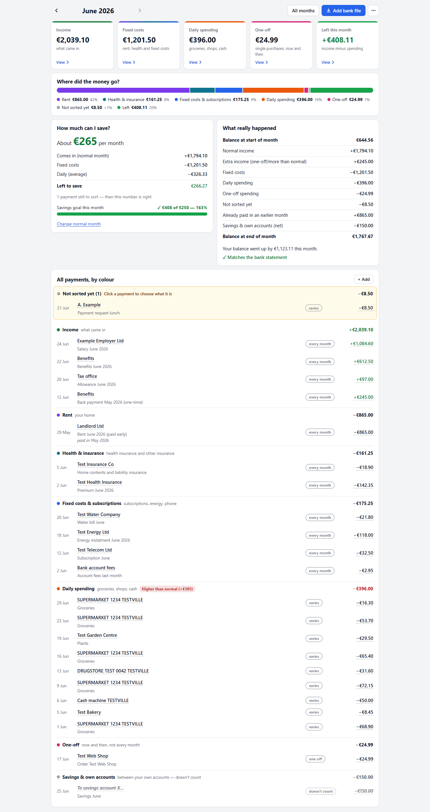
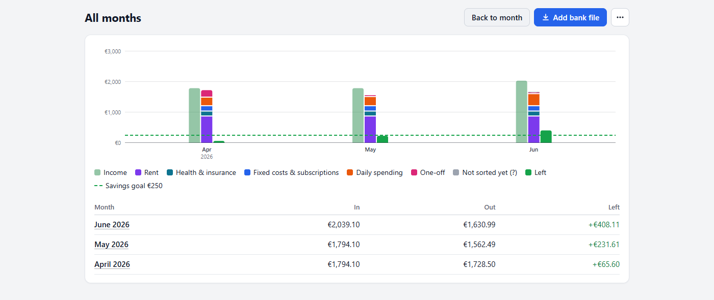
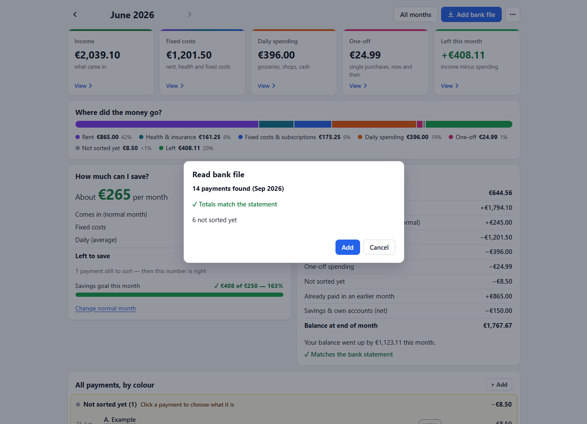

# Budget

A simple household budget app in **one HTML file**. You read in the bank statements of a Dutch **ING** current
account, and the app shows per month what came in, what went out, and how much you can save.

- Reads ING statements: the PDF statement ("Afschrift Betaalrekening") and the CSV download ("Af- en
  bijschrijvingen", Dutch or English column names).
- Sorts payments into categories by itself (rent, health, fixed costs, daily spending, one-off, savings) and
  learns from your choices.
- Month screen with tiles, a colour bar, "What really happened" (checked against the bank's own totals), a
  savings estimate and a savings goal. An "All months" chart and table.
- Backup and restore (a JSON file), print, undo for every change.
- Works **offline**. Nothing is sent anywhere: the page has a strict Content Security Policy that blocks all
  network use. Your data stays in your browser (localStorage) on your own computer.

The screens are in English. The bank files it reads are Dutch, so payment types and shop names from the bank
stay as the bank wrote them.

## What it looks like

All screenshots use the made-up demo data from `seed/demo-seed.json` and the fake test statement in
`test/fixtures/`.



*One month: what came in, what went out, how much you can save, and every payment by category.*



*All months: a chart and a table with in, out and left per month.*



*Reading a bank file: the app checks the totals against the statement before you add the payments.*

## What you need

- To **use** it: any modern browser (Edge, Chrome, Firefox, LibreWolf).
- To **build** it: [Node.js](https://nodejs.org/) 24 or newer. There is nothing to `npm install`.

## Build

```
node build/build.mjs
```

This makes `dist/Budget.html`. Open that file in your browser. That is the whole app.

To try it with made-up demo data (three months of fake payments):

```
node build/build.mjs --seed seed/demo-seed.json --out dist/Budget-demo.html
```

(`npm run build` and `npm run build:demo` do the same.)

## Install on Windows (optional)

```
powershell -NoProfile -ExecutionPolicy Bypass -File tools\install.ps1
```

This copies `dist/Budget.html` to a `Budget` folder in your user profile and makes a desktop shortcut "Budget".
Use `-Target <folder>` for another folder and `-NoShortcut` to skip the shortcut. An older copy is kept in
`<folder>\old\`.

## Where your data is

Everything you read in or change is kept in your browser's own storage for this page. It is not in the HTML
file, so you can replace the file with a newer build and keep your data. Clearing your browser's site data
removes it, so make a backup now and then (menu `⋯` › Make backup). A backup is a file named
`budget-backup-YYYY-MM-DD.json`; keep it somewhere safe, it holds your payments.

Keep your real bank files and backups outside this project folder (or in its `private/` folder). The
`.gitignore` keeps PDF, CSV and JSON files out of git, except the made-up ones the project ships, but it is
safer not to have real ones here at all.

## Test

```
node --test "test/unit/*.test.mjs"
```

(or `npm test`). These tests use fake data only. A few also run other programs: the install check runs
`powershell.exe` (Windows only), and the repo checks run `git` (skipped without git). Scratch files go to the
git-ignored `.tmp/` folder or your system temp folder. One check puts a made-up, git-ignored
`budget-backup-scan-check-*.json` file in the project folder for a moment and deletes it again. One check in `import-pdf.test.mjs` also starts headless browsers; it only runs
with `BUDGET_BROWSER=1`.

End-to-end tests drive the real built page in a headless browser:

```
node test/e2e/edge.mjs                 # Microsoft Edge
node test/e2e/gecko.mjs [--firefox]    # LibreWolf, or Firefox
```

They expect Edge, LibreWolf or Firefox in their standard install folders. If you point `TEMP`/`APPDATA` at other
folders for a test run, use normal Windows paths with backslashes (not forward-slash paths from a bash shell), or LibreWolf/Firefox
may close right at start. All test data in `test/fixtures` and
`seed/` is made up.

The fixture generators (`test/fixtures/make-fixtures.mjs`, `make-holder-fixtures.mjs`) need Edge and overwrite the
fixtures in that folder; the tests expect the fixtures as they are committed.

## Known limits

- Only ING (Netherlands) current-account statements are read. Savings-account downloads and other banks are not.
- A name you type for a payment is stored as you typed it.
- Payee rules match the exact bank name.
- "Today" (the date of a payment you add, the backup file name) comes from your browser's clock. Browsers with
  fingerprint protection, such as LibreWolf, report UTC time, so shortly after midnight that date can be the day
  before.
- After you remove a word from "Hide words", the hidden text does not come back (the app does not keep the
  bank's original text).

## Credits

- [PDF.js](https://mozilla.github.io/pdf.js/) by Mozilla, version 6.4.299, Apache License 2.0. It is in
  `vendor/` unchanged, with its license in `vendor/LICENSE` and its checksums in `vendor/VERSION.txt`. The build
  puts it inside `Budget.html`.

Built with [Claude Code](https://claude.com/claude-code).

## License

MIT, see [LICENSE](LICENSE). PDF.js in `vendor/` keeps its own Apache 2.0 license.
